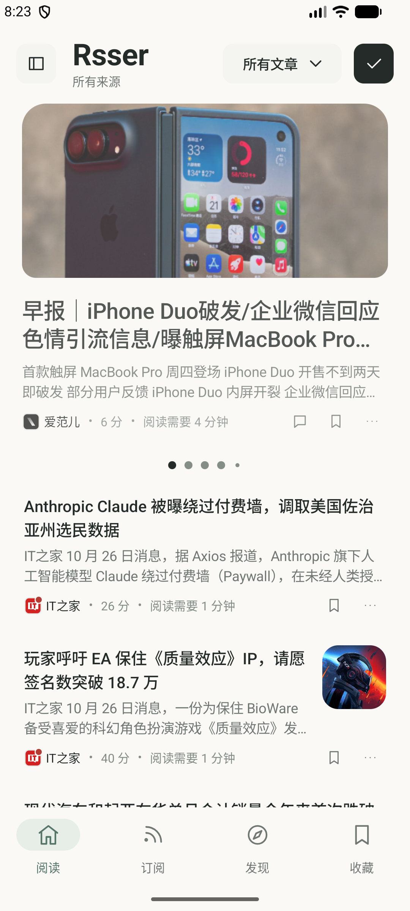
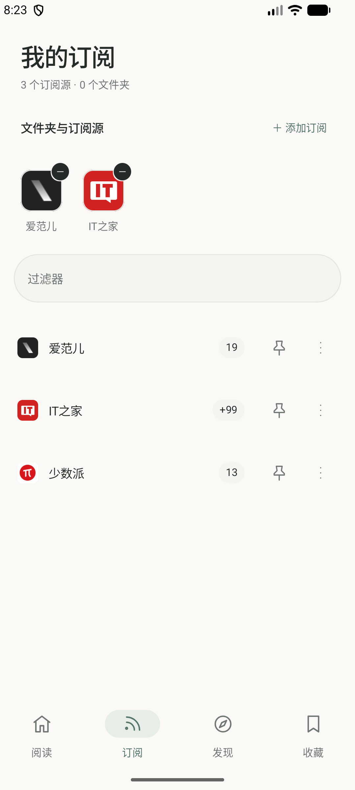
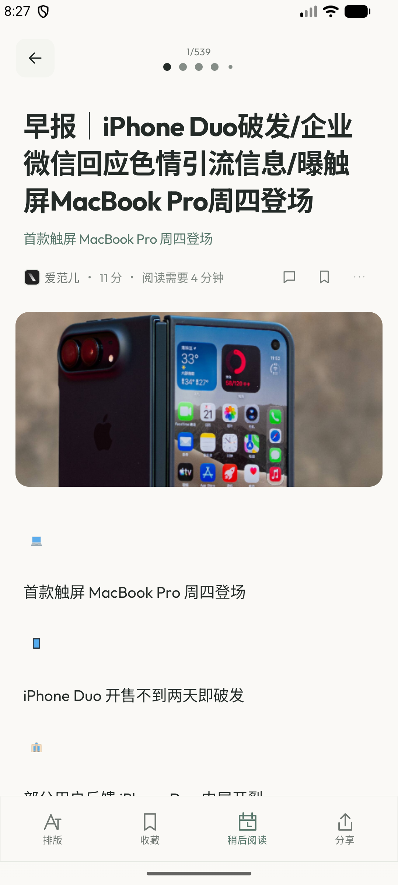

# Rsser

Rsser 是一款 Android RSS 阅读器。本版本于 **2026 年 10 月修订**，以 GPLv3 发布。

## 本版变化

- 手机端增加「阅读、发现、收藏、订阅」四个主入口，订阅管理不再藏在抽屉中。
- 阅读流与订阅管理采用统一的暖色背景、卡片层级和紧凑信息排布。
- 在订阅页选择信息源后会自动返回阅读页，减少管理和阅读之间的往返操作。
- 文章阅读底栏调整为四个等宽操作区，改善图标、文字和底部安全区的比例。
- 保留 Rsser 应用名称与图标；应用深链 scheme 统一为 `rsser://`。

## 运行截图

以下截图来自 Android Emulator API 37 上运行的 Rsser，分辨率为 1080 × 2400。

### 阅读信息流



### 订阅管理



### 文章阅读与底部操作栏



## 构建

### 环境要求

- Android Studio 与 Android SDK Platform 37
- JDK 21

### 编译与运行

在 Android Studio 中打开仓库目录，等待 Gradle 同步完成，选择 `app` 运行配置和 Android 模拟器启动。

也可以在已配置 JDK 21 与 Android SDK 的终端执行：

```sh
./gradlew :app:assembleFossDebug
```

项目提供 `full` 与 `foss` 两种 product flavor。FOSS 调试版本不需要 release 签名凭据；完整版本可通过 `:app:assembleFullDebug` 编译。

## 许可

本软件按 GNU General Public License v3.0（GPLv3）授权，完整条款见 [LICENSE.txt](LICENSE.txt)。源码中的版权与许可声明保留。
